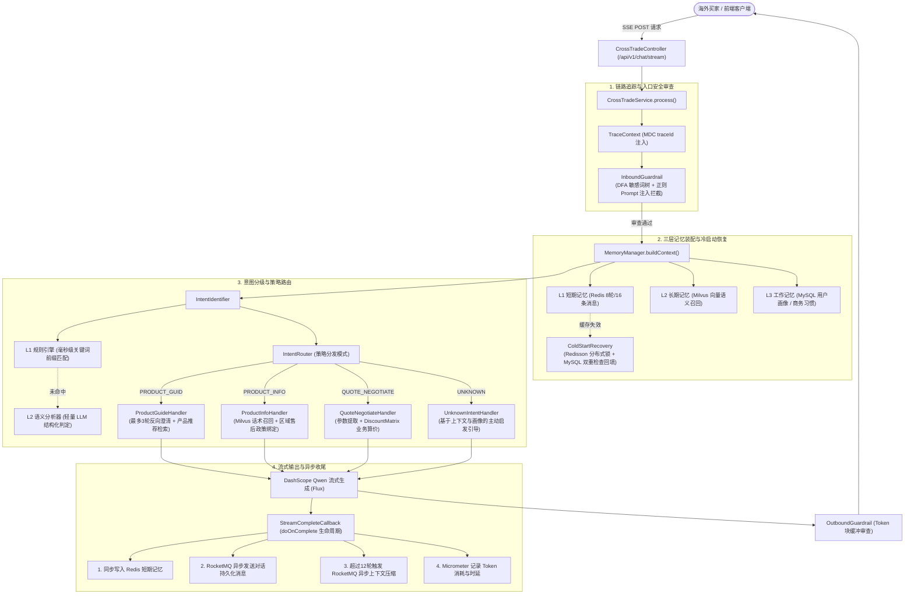

# CrossTrade Agent

> 基于 Spring AI Alibaba 与通义千问的多 Agent 跨境电商智能营销系统，提供入口安全审查、意图分级路由、RAG 领域检索、确定性折扣矩阵与三层记忆治理（Redis / Milvus / MySQL / RocketMQ）全链路工程实现。

<div align="center">

[](https://www.oracle.com/java/)
[](https://spring.io/projects/spring-boot)
[](https://github.com/alibaba/spring-ai-alibaba)
[](https://help.aliyun.com/zh/model-studio/)
[](https://redis.io/)
[](https://milvus.io/)
[](https://rocketmq.apache.org/)
[](https://vuejs.org/)
[](https://www.typescriptlang.org/)
[](LICENSE)

</div>

---

## 目录

- [一、 业务痛点与技术定义](#一-业务痛点与技术定义)
- [二、 整体架构与执行链路](#二-整体架构与执行链路)
- [三、 核心子系统工程实现](#三-核心子系统工程实现)
- [四、 领域模型与存储设计](#四-领域模型与存储设计)
- [五、 工程目录拓扑](#五-工程目录拓扑)
- [六、 核心 API 与协议规范](#六-核心-api-与协议规范)
- [七、 环境基线与配置字典](#七-环境基线与配置字典)
- [八、 本地开发与快速运行](#八-本地开发与快速运行)
- [九、 自动化测试套件矩阵](#九-自动化测试套件矩阵)
- [十、 零信任安全防御与已知边界](#十-零信任安全防御与已知边界)
- [十一、 开源许可证](#十一-开源许可证)

---

## 一、 业务痛点与技术定义

在传统跨境电商（B2B / 独立站出海）场景中，服务链路面临四个核心瓶颈：

1. **时区差异导致高价值询盘流失**：海外买家在非工作时段咨询时，人工客服无法实时介入，买家转向竞品商家；
2. **多语言与深度商务沟通壁垒**：买家除了解产品基础规格外，更关注材料竞争优势、定制起订量（MOQ）以及目标市场的退换货政策（US / EU / UK 等本地化合规）；
3. **模糊需求与导购转化困难**：买家需求参数不完整时，缺少多轮反向澄清与精准选品推荐机制；
4. **讨价还价与防套利风险**：若直接允许大模型进行价格谈判，容易因模型提示词注入产生越权低价承诺，造成利润损失。

CrossTrade Agent 通过构建“确定性业务引擎 + 大模型生成润色”双轨架构，将权限卡点、折扣算法与多层记忆调度收敛于受控代码中，大模型负责语义理解、反向澄清话术生成与销售建议表达，保障业务安全性与转化效率。

---

## 二、 整体架构与执行链路



---

## 三、 核心子系统工程实现

### 1. 双层安全审查防护网

系统在输入与输出两侧建立防御隔离：

- **入口同步审查（InboundGuardrail）**：
  - 基于 `DfaSensitiveFilter` 实现确定有限自动机多叉树字典查找，时间复杂度为 O(N)，高效阻断违禁词汇；
  - 基于 `PromptInjectionDetector` 预置正则特征库，对“忽略上文指令”、“角色越狱提权”、“系统提示词嗅探”、“规则覆盖欺骗”进行快速识别，拦截后直接返回规范化拒绝文案，不进入大模型推理。
- **出口分块审查（OutboundGuardrail）**：
  - 基于 `OutputBuffer` 维持 20-Token 的滑动分块缓冲区；
  - 对流式输出进行轻量模型异步语义审查与 DFA 规则兜底，防止违规内容流出。

### 2. 双层意图识别与策略分发

系统采用“快路径规则过滤 + 慢路径模型兜底”的双层架构：

- **L1 规则引擎（RuleEngine）**：通过有序关键词矩阵对导购、咨询、报价进行前置判定，响应时延低于 1ms；
- **L2 语义分析（LlmIntentAnalyzer）**：未命中规则时调用通义千问进行四分类判定，并设置结构化容错兜底；
- **解耦路由设计（IntentRouter）**：利用 Spring 自动收集所有 `IntentHandler` 实例，消除多层 `if-else` 分支：
  - `ProductGuideHandler`：引入反向澄清计数器（`clarifyRound`），在买家缺少场景、预算或起订量时，最多进行 3 轮精准追问，超限则优雅降级为通用推荐；
  - `ProductInfoHandler`：结合买家所属国家与地区（US / EU / UK 等），自动挂载区域售后与退换货 SOP；
  - `QuoteNegotiateHandler`：执行结构化参数抽取与确定性折扣算价；
  - `UnknownIntentHandler`：依据最近讨论主题与买家历史画像生成针对性引导提问。

### 3. 三层记忆治理体系与上下文工程

为兼顾推理时延、上下文窗口容量与买家画像沉淀，系统设计了分层生命周期机制：

| 记忆层级 | 承载媒介 | 存储结构与窗口策略 | 职责定位 |
| :--- | :--- | :--- | :--- |
| **L1 短期记忆** | Redis | `session:messages:{sessionId}` (List)<br>`session:state:{sessionId}` (Hash)<br>`session:todo:{sessionId}` (List) | 保留最近 8 轮（16 条）核心对话，每次交互通过 `expireAll` 滑动重置 24 小时 TTL，保障跨时区对话连续性。 |
| **冷启动恢复** | Redisson + MySQL | `RLock`（3秒等待、10秒租期）+ 双重校验锁（DCL） | 针对数天后重返会话导致的 Redis 缓存击穿，通过分布式锁从 MySQL 按时间正序回填最近 16 条对话及待办任务。 |
| **L2 长期记忆** | Milvus + MySQL | Milvus `memory_fragments` (向量) + MySQL `agent_memory_fragments` | 保存脱水压缩后的事实摘要片段，支持跨会话语义相似度召回。保留 180 天，到期由定时任务归档。 |
| **L3 工作记忆** | MySQL | `user_working_memory` (一户一行) | 维护买家标签矩阵（JSON）、自然语言商务谈判习惯及工具调用频次，供模型生成个性化回复。 |
| **上下文压缩** | RocketMQ | Topic: `crosstrade-compress-topic` | 当会话累计轮数超过 12 轮时，截取滑动窗口外历史消息异步提炼高密度事实并写入 L2，Redis 窗口重置为 8 轮。 |

### 4. 确定性防套利报价决策（DiscountMatrix）

大模型严禁直接决定成交底价与让利幅度。系统采用严格的职责划分：

```
买家提问 -> QuoteNegotiateHandler 抽取参数 (productId, quantity, expectedPrice)
         -> DiscountMatrix (Java 业务逻辑计算最优底价与阶梯折扣)
         -> 生成确定性算价结果 (accepted, finalPrice, minPrice)
         -> 注入 Prompt 由模型润色为专业销售话术并输出
```

- **阶梯满减规则**：满 50 件优惠 5%、满 100 件优惠 10%、满 500 件优惠 15%、满 1000 件优惠 20%；
- **底价刚性红线**：根据产品配置的最低限价 `minPrice` 进行 `BigDecimal` 边界卡死，低于成本价的报价强制回绝并反推最优可行方案，规避提示词越狱套利。

---

## 四、 领域模型与存储设计

数据库建表脚本位于 [sql/dbscript.sql](sql/dbscript.sql)，包含五张核心数据表：

```sql
-- 1. 全量历史对话表 (支持全链路审计与冷启动加载)
CREATE TABLE `agent_chat_history` (
    `id`         BIGINT       NOT NULL AUTO_INCREMENT,
    `session_id` VARCHAR(64)  NOT NULL COMMENT '会话唯一标识',
    `user_id`    VARCHAR(64)  NOT NULL COMMENT '买家唯一标识',
    `role`       VARCHAR(20)  NOT NULL COMMENT 'user / assistant / system / tool',
    `content`    TEXT         NULL     COMMENT '原始对话文本',
    `tool_calls` JSON         NULL     COMMENT '工具调用结构化参数',
    `raw_tokens` INT          NOT NULL DEFAULT 0 COMMENT '单轮消耗 Token 统计',
    `created_at` TIMESTAMP    NOT NULL DEFAULT CURRENT_TIMESTAMP,
    PRIMARY KEY (`id`),
    INDEX `idx_session_time` (`session_id`, `created_at` DESC),
    INDEX `idx_user_id` (`user_id`)
) ENGINE=InnoDB DEFAULT CHARSET=utf8mb4 COLLATE=utf8mb4_unicode_ci;

-- 2. L2 摘要压缩表 (保留 180 天高密度事实记忆)
CREATE TABLE `agent_memory_fragments` (
    `id`            BIGINT        NOT NULL AUTO_INCREMENT,
    `user_id`       VARCHAR(64)   NOT NULL,
    `session_id`    VARCHAR(64)   NOT NULL,
    `fragment_text` VARCHAR(1024) NOT NULL COMMENT '提炼事实摘要',
    `category`      VARCHAR(32)   NOT NULL DEFAULT 'COMMERCE' COMMENT 'COMMERCE / AFTER_SALES / PERSONAL',
    `vector_failed` TINYINT(1)    NOT NULL DEFAULT 0 COMMENT '向量写入补偿标记',
    `created_at`    TIMESTAMP     NOT NULL DEFAULT CURRENT_TIMESTAMP,
    PRIMARY KEY (`id`),
    INDEX `idx_user_time` (`user_id`, `created_at`),
    INDEX `idx_created_at` (`created_at`)
) ENGINE=InnoDB DEFAULT CHARSET=utf8mb4 COLLATE=utf8mb4_unicode_ci;

-- 3. L3 买家工作记忆与画像表 (一户一行)
CREATE TABLE `user_working_memory` (
    `user_id`         VARCHAR(64) NOT NULL,
    `summary_tags`    JSON        NOT NULL COMMENT '地区、偏好等结构化标签',
    `business_habits` TEXT        NOT NULL COMMENT '商务谈判习惯与偏好',
    `tool_preference` JSON        NOT NULL COMMENT '工具调用频次统计',
    `version`         BIGINT      NOT NULL DEFAULT 0 COMMENT '并发控制版本号',
    `updated_at`      TIMESTAMP   NOT NULL DEFAULT CURRENT_TIMESTAMP ON UPDATE CURRENT_TIMESTAMP,
    PRIMARY KEY (`user_id`)
) ENGINE=InnoDB DEFAULT CHARSET=utf8mb4 COLLATE=utf8mb4_unicode_ci;

-- 4. 会话待办事项表 (支持长事务跟踪与冷启动回填)
CREATE TABLE `agent_session_todo` (
    `id`           BIGINT       NOT NULL AUTO_INCREMENT,
    `session_id`   VARCHAR(64)  NOT NULL,
    `todo_content` VARCHAR(255) NOT NULL,
    `status`       VARCHAR(20)  NOT NULL DEFAULT 'PENDING' COMMENT 'PENDING / COMPLETED / CANCELED',
    `created_at`   TIMESTAMP    NOT NULL DEFAULT CURRENT_TIMESTAMP,
    `updated_at`   TIMESTAMP    NOT NULL DEFAULT CURRENT_TIMESTAMP ON UPDATE CURRENT_TIMESTAMP,
    PRIMARY KEY (`id`),
    INDEX `idx_session_status` (`session_id`, `status`)
) ENGINE=InnoDB DEFAULT CHARSET=utf8mb4 COLLATE=utf8mb4_unicode_ci;

-- 5. L2 记忆归档表 (数据滚动迁移防膨胀)
CREATE TABLE `agent_memory_fragments_archive` (
    `id`            BIGINT        NOT NULL,
    `user_id`       VARCHAR(64)   NOT NULL,
    `session_id`    VARCHAR(64)   NOT NULL,
    `fragment_text` VARCHAR(1024) NOT NULL,
    `category`      VARCHAR(32)   NOT NULL,
    `created_at`    TIMESTAMP     NOT NULL,
    `archived_at`   TIMESTAMP     NOT NULL DEFAULT CURRENT_TIMESTAMP,
    PRIMARY KEY (`id`),
    INDEX `idx_archive_user` (`user_id`)
) ENGINE=InnoDB DEFAULT CHARSET=utf8mb4 COLLATE=utf8mb4_unicode_ci;
```

---

## 五、 工程目录拓扑

```
crosstrade-agent
├── crosstrade-common                  # 通用基础模块
│   └── src/main/java/com/crosstrade/common
│       ├── constants/                 # 业务常量、MQ Topic、Redis Key 规范
│       ├── dto/                       # 请求 DTO (ChatRequest) 与响应模型
│       ├── entity/                    # JPA 数据实体模型 (5 张核心表)
│       ├── enums/                     # 意图类型、审查状态、记忆分类枚举
│       ├── exception/                 # 统一业务异常与边界拦截异常
│       ├── repository/                # Spring Data JPA 仓储接口
│       └── util/                      # DFA 敏感词过滤器、Prompt 注入检测器
├── crosstrade-core                    # Agent 核心业务模块
│   └── src/main/java/com/crosstrade/core
│       ├── callback/                  # 流式输出完成回调 (StreamCompleteCallback)
│       ├── config/                    # Spring AI、Milvus、Redisson、Resilience4j 配置
│       ├── guardrail/                 # 入口与出口安全审查实现
│       ├── intent/                    # L1 规则引擎与 L2 语义分析识别器
│       ├── memory/                    # 三层记忆管理器、冷启动恢复、上下文压缩
│       ├── mq/                        # RocketMQ 生产者与持久化/压缩消费者
│       ├── observe/                   # MDC 链路追踪上下文与 Micrometer 指标采集
│       ├── rag/                       # Milvus 向量检索与本地化政策增强器
│       ├── router/                    # 意图路由器与四大业务处理器 (Handler)
│       ├── schedule/                  # 用户画像更新与历史记忆归档定时任务
│       ├── service/                   # 核心流水线调度服务 (CrossTradeService)
│       └── tool/                      # 阶梯折扣矩阵 (DiscountMatrix) 与产品检索工具
├── crosstrade-api                     # 接口控制层
│   └── src/main/java/com/crosstrade/api
│       ├── advice/                    # 全局异常捕获处理 (GlobalExceptionHandler)
│       └── controller/                # SSE 流式会话接口与生命周期控制接口
├── crosstrade-app                     # 应用装配与运行入口
│   └── src/main/resources
│       └── application.yaml           # 全量应用配置
├── crosstrade-web                     # 前端工程 (Vue 3 + TypeScript + UnoCSS)
│   ├── src/
│   │   ├── components/                # 消息气泡、商品推荐卡片、报价单卡片、地区选择器
│   │   ├── composables/               # 会话管理与 SSE 流消费逻辑
│   │   ├── services/                  # 原生 Fetch + ReadableStream SSE 客户端
│   │   └── utils/                     # DOMPurify XSS 过滤、Markdown 解析器
│   └── __tests__/                     # Vitest 单元与集成测试套件 (15 组用例)
├── docs/                              # 研发教学指南与全量代码参考
├── sql/                               # 数据库初始化 DDL 脚本
├── .env.example                       # 环境变量模版字典
└── pom.xml                            # 父 POM 依赖版本统管
```

---

## 六、 核心 API 与协议规范

### 1. SSE 流式对话端点

- **路径**：`POST /api/v1/chat/stream`
- **请求类型**：`application/json`
- **响应类型**：`text/event-stream`
- **请求载荷**：
  ```json
  {
    "sessionId": "488bf3a958ce43d5bc46d37784e91fbb",
    "userId": "usr_9921",
    "message": "我想订购100顶野营帐篷TENT-X1，送往美国洛杉矶，请问支持定制印刷Logo吗？报价多少？",
    "region": "US"
  }
  ```
- **SSE 事件流格式**：
  ```
  data:{"type":"token","content":"您","tokenIndex":0}
  data:{"type":"token","content":"好","tokenIndex":1}
  ...
  data:{"type":"done","sessionId":"488bf3a958ce43d5bc46d37784e91fbb","totalTokens":186,"intentType":"quote_negotiate"}
  ```

### 2. 会话管理端点

| 端点 | 请求方法 | 描述 |
| :--- | :--- | :--- |
| `/api/v1/session/create` | POST | 创建新会话，生成服务端受控的 `sessionId` |
| `/api/v1/session/recover` | POST | 主动触发冷启动恢复，从 MySQL 回填近期会话至 Redis |
| `/api/v1/session/close` | POST | 正常结束会话，释放 Redis 短期上下文缓存 |
| `/api/v1/chat/sync` | POST | 同步调用接口，用于自动化测试与调试 |

---

## 七、 环境基线与配置字典

### 1. 运行环境基线

- **Java Development Kit**：JDK 17 或更高版本
- **Apache Maven**：3.8.0 或更高版本
- **Node.js**：18.18.0 或更高版本，npm 9.x+
- **MySQL**：8.0+
- **Redis**：6.2+
- **Apache RocketMQ**：4.9+ 或 5.x
- **Milvus**：2.4.4+

### 2. 核心配置字典 (.env.example)

根目录提供 [.env.example](.env.example)，系统配置项对应如下：

| 配置项 | 环境变量名 | 默认值 / 示例 | 是否必填 | 说明 |
| :--- | :--- | :--- | :--- | :--- |
| 大模型密钥 | `DASHSCOPE_API_KEY` | `sk-xxxxxxxxxxxxxxxx` | **是** | 阿里云 DashScope 通义千问调用密钥 |
| 核心端口 | `SERVER_PORT` | `8088` | 否 | 后端应用监听端口 |
| 数据库连接 | `MYSQL_HOST` | `127.0.0.1` | **是** | MySQL 实例地址 |
| 数据库库名 | `MYSQL_DATABASE` | `crosstrade_agent` | **是** | 业务主库名称 |
| 缓存地址 | `REDIS_HOST` | `localhost` | **是** | Redis 主机地址 |
| 缓存端口 | `REDIS_PORT` | `6379` | 否 | Redis 端口 |
| 消息队列服务 | `ROCKETMQ_NAME_SERVER` | `127.0.0.1:9876` | **是** | RocketMQ NameServer 集群地址 |
| 向量数据库 | `MILVUS_HOST` | `127.0.0.1` | **是** | Milvus 实例主机地址 |
| 向量库端口 | `MILVUS_PORT` | `19530` | 否 | Milvus RPC 端口 |

---

## 八、 本地开发与快速运行

### 1. 数据库与中间件初始化

```bash
# 1. 初始化 MySQL 表结构
mysql -u root -p < sql/dbscript.sql

# 2. 确认 Redis、Milvus 与 RocketMQ 服务已正常运行
# 验证 Redis 连接
redis-cli ping

# 验证 RocketMQ 状态
mqadmin clusterList -n 127.0.0.1:9876
```

### 2. 后端服务构建与启动

```bash
# 设置 DashScope API Key
export DASHSCOPE_API_KEY="sk-your-valid-key"

# 编译并打包 Maven 工程
mvn clean package -DskipTests

# 启动 Spring Boot 后端应用
java -jar crosstrade-app/target/crosstrade-app-1.0.0.jar
```

服务启动后，OpenAPI 文档可通过浏览器访问：`http://localhost:8088/swagger-ui.html`。

### 3. 前端界面启动

```bash
cd crosstrade-web

# 安装依赖
npm install

# 启动 Vite 开发服务器
npm run dev
```

浏览器打开 `http://localhost:5173` 即可进入跨境贸易智能营销工作台。

---

## 九、 自动化测试套件矩阵

项目提供完备的端到端与模块级自动化测试验证：

```bash
# 运行后端单元测试
mvn test

# 运行前端测试套件 (覆盖组件、SSE 流解析、XSS 防护与集成链路)
cd crosstrade-web && npm run test:run
```

前端已落地的自动化测试用例清单（15 组）：

| 测试类别 | 测试文件路径 | 核心验证断言 |
| :--- | :--- | :--- |
| **组件测试** | `__tests__/components/ChatInput.test.ts` | 输入框空值校验、回车快捷发送、防抖机制 |
| **组件测试** | `__tests__/components/IntentTag.test.ts` | 导购、咨询、报价等标签属性渲染准确性 |
| **组件测试** | `__tests__/components/MessageBubble.test.ts` | Markdown 转换、用户与 Agent 气泡排版 |
| **组件测试** | `__tests__/components/ProductCard.test.ts` | 阶梯起订量、规格属性与加购交互 |
| **组件测试** | `__tests__/components/QuoteCard.test.ts` | 阶梯折扣计算结果与底价标签绑定 |
| **组件测试** | `__tests__/components/RegionSelector.test.ts` | 区域切换触发上下文变更事件 |
| **核心工具** | `__tests__/unit/sse-parser.test.ts` | 跨数据包拆帧与畸变事件容错解析 |
| **核心工具** | `__tests__/unit/xss-sanitizer.test.ts` | DOMPurify 针对恶意脚本与注入标记的过滤隔离 |
| **集成流测** | `__tests__/integration/sse-stream.test.ts` | 完整 SSE Token 接收、累加与 Done 事件时序 |
| **集成流测** | `__tests__/integration/session-management.test.ts` | 会话创建、冷启动重连与上下文释放链路 |

---

## 十、 零信任安全防御与已知边界

为保障系统的技术透明性与生产准入严谨度，系统明确以下防御设计与已知演进边界：

1. **向量维度对齐要求**：当前 `MilvusConfig` 中集合向量维度配置为 1536，通义千问 `text-embedding-v3` 默认输出维度为 1024。生产部署前需在配置中心将向量集合参数与模型输出保持严格一致；
2. **敏感词库动态热更新**：当前 `DfaSensitiveFilter` 支持内存构建字典树。大规模生产环境下，推荐挂载外部配置中心（如 Nacos）或数据库变更监听，实现违禁词不停机热加载；
3. **MDC 跨异步线程传递**：Reactor 响应式线程切换与 RocketMQ 异步消费时，需配置操作符挂载或自定义解码器，以确保 `traceId` 在分布式调用链路中实现闭环追踪；
4. **出口审查接入流处理**：`OutboundGuardrail` 具备完整的缓冲校验能力，生产环境建议将其直接封装进 Reactor 流的 `map` 操作符中，实现逐块实时阻断。

---

## 十一、 开源许可证

本项目基于 [Apache License 2.0](LICENSE) 开源协议分发与使用。
